# Proofs

**11 published projects:** 8 checked in [Lean](https://lean-lang.org/) and 3 written proofs with reproducible computer checks. Each project links to its source and replay instructions. Some formalizations certify earlier constructions; 11 is the number of projects, not a count of new discoveries.

The two lists are oldest first. The ages run from the earliest formulation we located to the November 2026 result. They do not imply a problem stayed open throughout.

## Lean-checked results

1. **1992 · [Finite triangle-free networks with a fresh witness](proofs/finite-ectf/README.md).** Pick a size limit. A finite triangle-free network can be built so that every small request for a new node to connect to one group and avoid another is met, as long as the group it connects to contains no links. The theorem works for every size limit. [Cherlin, Problems 8–9](https://sites.math.rutgers.edu/~cherlin/Paper/1992CombProblems.pdf), about 34 years. Lean checks the finite graph claim; Henson pseudofiniteness follows by a known equivalence.

   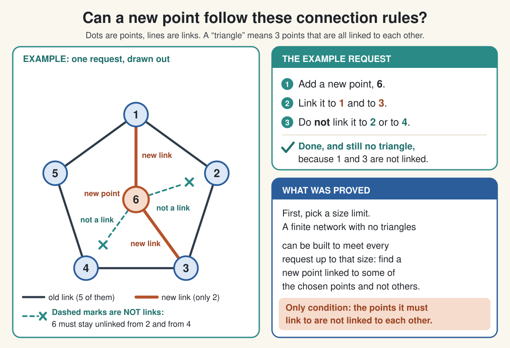

   *A single extension request, not a whole graph with the extension property.*

2. **2012 · [Two thin-cuboid counterexamples](proofs/thin-cuboid/README.md).** Remove a cube only when it touches exactly three remaining cubes by a face. These two dismantlings leave 17 isolated cubes in a 2 × 3 × 9 block and 15 in a 3 × 3 × 6 block, refuting two clauses of [Barát and Wanless’s conjecture](https://arxiv.org/html/2603.23913#S6). The [earlier constructions](https://arxiv.org/abs/2209.07594) are newly checked in Lean here, about 14 years after the stated problem.

   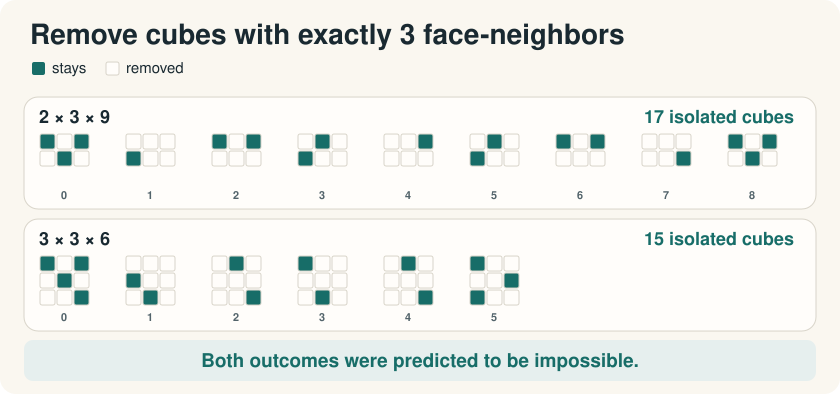

   *Filled cells show the actual survivors checked in Lean.*

3. **17 Dec 2025 · [A same-color five-step loop](proofs/plane-c5/README.md).** Color every point of the plane with either of two colors. Five distinct points of one color always form a loop of five unit-length steps. It need not be a regular pentagon, and the coloring need not be measurable. [Axenovich, Liu and Sagdeev, Question 3](https://arxiv.org/html/2512.15516v3#S6.SS1), about 11 months.

   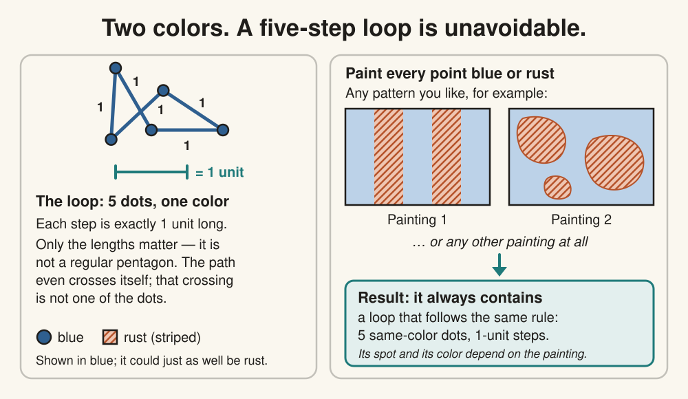

   *An example loop from the two-circle construction; the theorem applies to every two-coloring.*

4. **17 Apr 2026 · [Odd edge coloring](proofs/odd-edge-coloring/README.md).** Paint the edges with at most three colors so each color occurs at each vertex either zero times or an odd number of times. This always works in a simple graph with an odd number of vertices, at least four edges at every vertex, and connectivity that survives removing any two vertices. [Kano, Maezawa and Ozeki, Conjecture 6](https://arxiv.org/html/2604.15824), about 7 months.

   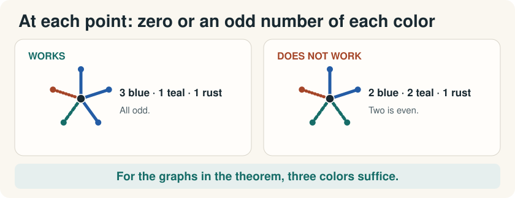

   *A local illustration of the rule, not a coloring of an entire graph.*

5. **8 Jun 2026 · [Uniqueness of tetrahedral dessins](proofs/ak14-dessins/README.md).** In two families of maps on a sphere, the branching data at three fixed points determine the whole oriented map up to relabeling. Lean checks uniqueness in every degree; the [original paper](https://arxiv.org/html/2606.10079#S1.SS4) separately proves existence. About 5 months.

   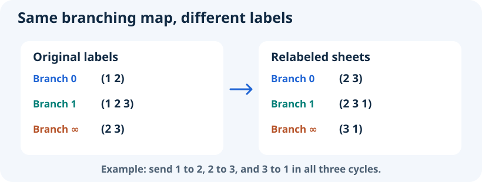

   *The same relabeling must work for all three branches.*

6. **2 Jul 2026 · [How many swaps between polygon matchings?](proofs/polygon-matching-diameter/README.md).** Pair the numbered sides of a polygon, then glue them to make a surface with `g` handles. When there are `2g + 1` pairs, at most `32g` pair swaps connect any two matching patterns while preserving the handle count. That refutes [the proposed uniform lower bound](https://arxiv.org/html/2607.02410v1#S2), not every variant of the question. About 5 months.

   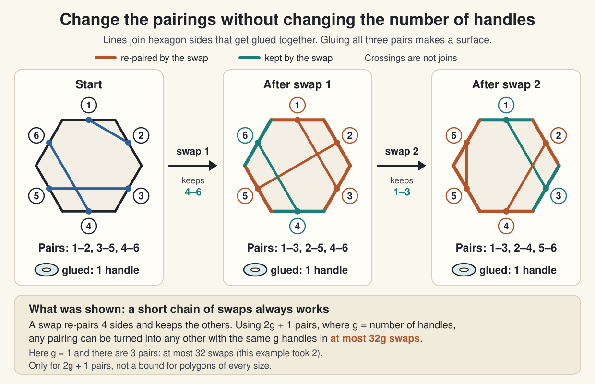

   *This two-swap example keeps one handle throughout.*

7. **14 Nov 2026 · [Box-free 11- and 16-cubes](proofs/boxfree-11/README.md).** Two colors suffice to color either cube grid so that no axis-aligned box has eight corners of the same color. The Lean certificates adapt [Menezes’s earlier construction](https://arxiv.org/html/2609.22381v2#S3). [Alm and Miller, Problem 1](https://arxiv.org/html/2611.19635v1#S8), 12 days.

   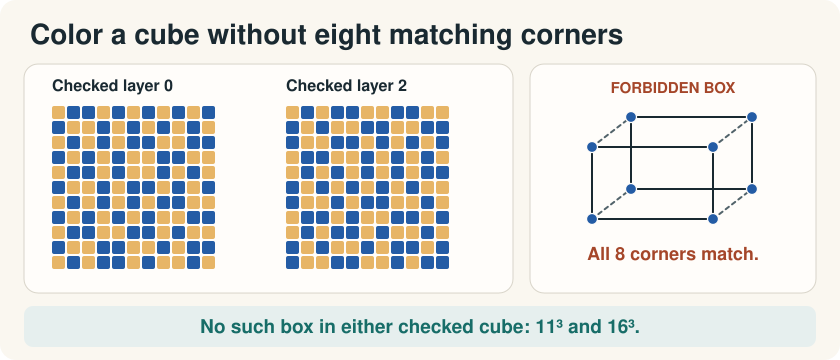

   *The proof checks every box in the cube, not just these two slices.*

8. **14 Nov 2026 · [Exactly 52 box-free layers](proofs/boxfree-5x7/README.md).** Stack two-colored 5 × 7 grids without creating a box with eight same-color corners. A checked 52-layer example meets the upper bound: 53 layers are impossible. [Alm and Miller, Problem 3](https://arxiv.org/html/2611.19635v1#S6), 12 days.

   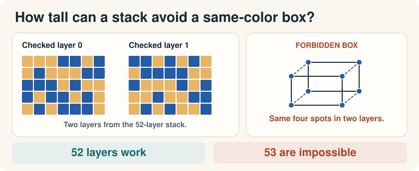

   *A same-color rectangle repeated in the same position across layers would make a forbidden box.*

## Written results with computer checks

1. **1979 · [Equal LCMs of six consecutive integers](research/erdos-lcm-six/README.md).** Two non-overlapping runs of six consecutive positive integers cannot have the same least common multiple, even when they are adjacent. Three overlapping pairs were already known. The new argument finishes the disjoint length-six case of [Erdős #677](https://www.erdosproblems.com/677), not the question for arbitrary lengths. About 47 years from the general question.

   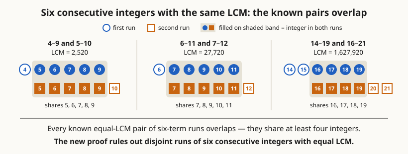

   *Every equal-LCM pair at this length overlaps.*

2. **2014 · [Eight-cycles in degree-3-critical graphs](research/degree-three-critical-c8/README.md).** Take a graph with `2n − 2` edges where every nonempty proper induced subgraph has a vertex of degree at most two. Once `n ≥ 8`, the graph must contain a loop through eight different vertices. This settles length eight in [Narins, Pokrovskiy and Szabó’s even-cycle question](https://arxiv.org/abs/1408.5289), not the whole family. About 12 years.

   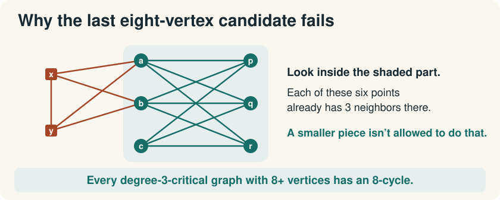

   *This proper subgraph rules out the remaining candidate type.*

3. **2019 · [Exactly 56 tests for ten binary flags](research/covering-array-55/README.md).** To test every on/off pattern on every selection of five out of ten flags, 56 runs suffice and 55 cannot. Exhaustively testing all ten together would take 1,024. This closes the [2019 lower-bound gap](https://www.sciencedirect.com/science/article/pii/S0096300319300864); the 56-run construction was known. About 7 years.

   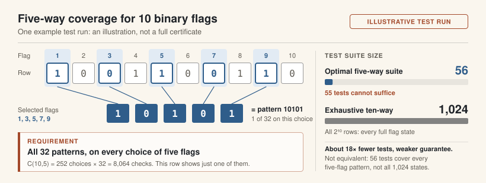

   *In a valid suite, all 32 patterns must occur on every choice of five flags.*
