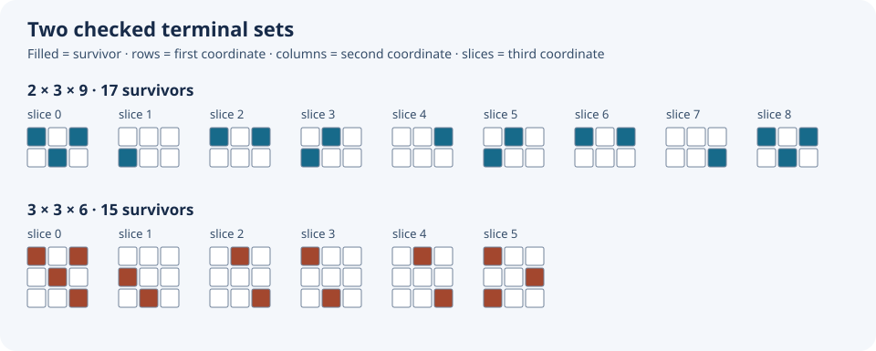

# Proofs

Lean-checked projects, ordered by the earliest located formulation of each problem. Dates below describe the statement-to-result window through November 2026; they do not establish priority or independent peer review.

*One extension request: A = {1, 3}, B = {2, 4}. The sixth vertex is adjacent to A and avoids B. This is a schematic of six records from the construction, not a six-vertex k-ECTF graph; the drawing makes no unit-distance claim.*

## Results, oldest question first

| First posed | Project and checked result | Timing and context |
| --- | --- | --- |
| **1992** | [Finite existentially complete triangle-free graphs](proofs/finite-ectf/README.md): a finite triangle-free graph with the fresh-witness extension property for every natural k. | Cherlin's [Problem 8 and equivalent finite extension formulation, Problem 9](https://sites.math.rutgers.edu/~cherlin/Paper/1992CombProblems.pdf), to this team's November 2026 result: about 34 years. The Lean theorem is the finite graph assertion; Henson pseudofiniteness is a mathematical consequence through the known equivalence, not formalized here. |
| **2012** | [Two thin-cuboid dismantlings](proofs/thin-cuboid/README.md): exact-degree deletion certificates for the 2 × 3 × 9 and 3 × 3 × 6 counterexamples. | Barát and Wanless, [Conjecture 2, §6](https://arxiv.org/html/2603.23913#S6). The instances use earlier constructions of [Dukes, Noel and Romer](https://arxiv.org/abs/2209.07594), newly certified here. |
| **2 Jul 2026** | [Polygon matching diameter](proofs/polygon-matching-diameter/README.md): labelled diameter at most 32g when n = 2g + 1, refuting a uniform joint lower bound. | Gross and Šarković, [Conjecture 2.10](https://arxiv.org/html/2607.02410v1#S2); about 5 months to the November 2026 result. The theorem does not settle every asymptotic regime. |
| **14 Nov 2026** | [11- and 16-cube box-free colorings](proofs/boxfree-11/README.md): the minimum number of monochromatic boxes is zero in both cubes. | Alm and Miller, [Problem 1](https://arxiv.org/html/2611.19635v1#S8). This adapts [Menezes's earlier construction](https://arxiv.org/html/2609.22381v2#S3); about 12 days from the statement to this team's formalization, not a claim of discovery priority or time open. |
| **14 Nov 2026** | [Exact box-free height for 5 × 7](proofs/boxfree-5x7/README.md): the largest height is 52, attaining the prior upper bound. | Alm and Miller, [Problem 3 and §6](https://arxiv.org/html/2611.19635v1#S8); about 12 days from the statement to this team's November 26 result. |

*Terminal sets from the checked zero labels in the thin-cuboid source. Each slice fixes the third coordinate; filled cells survive the deletion sequence.*

Future verified releases belong in the table by earliest located formulation, not by publication date. Ordering keys for later projects are unit C5 §6.1 (17 Dec 2025), odd-edge Conjecture 6 (17 Apr 2026), and dessins Conjecture 1.4 (8 Jun 2026); they enter the table only after their projects are verified and published.
