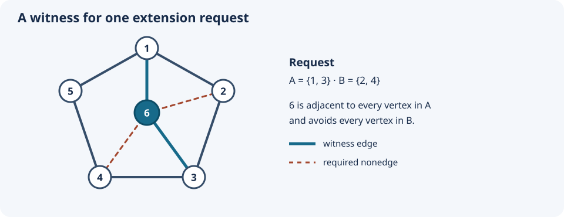
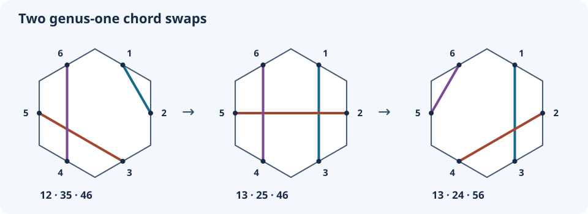
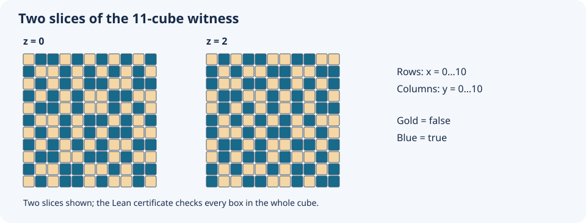
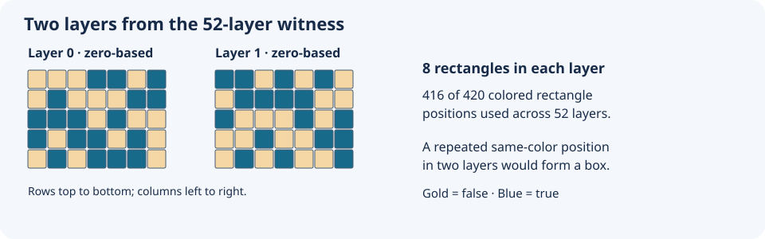
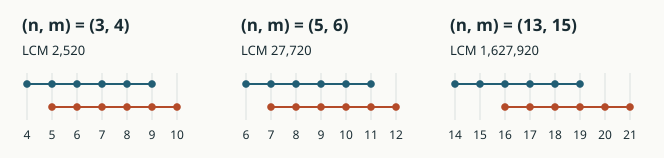
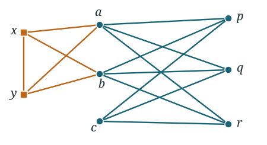
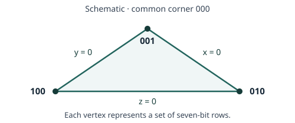

# Proofs

Lean-checked projects, ordered by the earliest located formulation of each problem. Dates below describe the statement-to-result window through November 2026; they do not establish priority or independent peer review.

This collection counts six projects, including new Lean certificates for the thin-cuboid and 11-cube results that formalize earlier constructions. The count also includes explicit proofs or disproofs of stated questions where no equivalent prior formalization or explicit writeup has been located. A certificate built from a prior construction is identified as such; the count and dates do not claim a global first or establish how long a result remained open.

## Results, oldest question first

1. **1992 — [Finite existentially complete triangle-free graphs](proofs/finite-ectf/README.md).** A finite triangle-free graph with the fresh-witness extension property for every natural k.

   Cherlin's [Problem 8 and equivalent finite extension formulation, Problem 9](https://sites.math.rutgers.edu/~cherlin/Paper/1992CombProblems.pdf), to this team's November 2026 result: about 34 years. The Lean theorem is the finite graph assertion; Henson pseudofiniteness is a mathematical consequence through the known equivalence, not formalized here.

   

   *One extension request: A = {1, 3}, B = {2, 4}. The sixth vertex is adjacent to A and avoids B. This is a schematic of six records from the construction, not a six-vertex k-ECTF graph; the drawing makes no unit-distance claim.*

2. **2012 — [Two thin-cuboid dismantlings](proofs/thin-cuboid/README.md).** Exact-degree deletion certificates for the 2 × 3 × 9 and 3 × 3 × 6 counterexamples.

   Barát and Wanless, [Conjecture 2, §6](https://arxiv.org/html/2603.23913#S6). The instances use earlier constructions of [Dukes, Noel and Romer](https://arxiv.org/abs/2209.07594), newly certified here; see also their [2022 preprint, §5](https://arxiv.org/html/2209.07594v1#S5). About 14 years elapsed between the 2012 statement and this team's 2026 Lean certificate; this does not assert the result was continuously open.

   

   *Terminal sets from the checked zero labels in the thin-cuboid source. Each slice fixes the third coordinate; filled cells survive the deletion sequence.*

3. **17 Apr 2026 — [Odd edge coloring](proofs/odd-edge-coloring/README.md).** Every finite simple 3-connected graph of odd order and minimum degree at least four has an odd edge coloring with at most three colors.

   Kano, Maezawa and Ozeki, [Conjecture 6](https://arxiv.org/html/2604.15824); about 7 months from the April 2026 statement to this team's November 2026 result. The project also checks earlier cases and a form of Tutte's nonseparating cycle theorem.

4. **2 Jul 2026 — [Polygon matching diameter](proofs/polygon-matching-diameter/README.md).** Labelled diameter at most 32g when n = 2g + 1, refuting a uniform joint lower bound.

   Gross and Šarković, [Conjecture 2.10](https://arxiv.org/html/2607.02410v1#S2); about 5 months to the November 2026 result. The theorem does not settle every asymptotic regime.

   

   *An illustrative two-swap path: the first swap keeps 46, the second keeps 13. Each matching has genus one; the theorem covers a broader family.*

5. **14 Nov 2026 — [11- and 16-cube box-free colorings](proofs/boxfree-11/README.md).** The minimum number of monochromatic boxes is zero in both cubes.

   Alm and Miller, [Problem 1](https://arxiv.org/html/2611.19635v1#S8). This adapts [Menezes's earlier construction](https://arxiv.org/html/2609.22381v2#S3); about 12 days from the statement to this team's formalization, not a claim of discovery priority or time open.

   

   *Two slices of the checked witness; Lean verifies the absence of monochromatic boxes throughout the whole cube.*

6. **14 Nov 2026 — [Exact box-free height for 5 × 7](proofs/boxfree-5x7/README.md).** The largest height is 52, attaining the prior upper bound.

   Alm and Miller, [Problem 3 and §6](https://arxiv.org/html/2611.19635v1#S8); about 12 days from the statement to this team's November 26 result.

   

   *Actual layers from the certificate. A same-color rectangle at the same coordinates in two layers would form a forbidden box; no such repetition occurs in the checked stack.*

Future verified releases belong in the list by earliest located formulation, not by publication date. Ordering keys for later projects are unit C5 §6.1 (17 Dec 2025) and dessins Conjecture 1.4 (8 Jun 2026); they enter the list only after their projects are verified and published.

## Written results, oldest question first

These results have reproducible computational checks, but are not formalized in Lean.

1. **1979 — [Equal LCMs of six consecutive integers](research/erdos-lcm-six/README.md).** Two disjoint six-term runs cannot have the same least common multiple, even if they are adjacent. This resolves a fixed-length case of Erdős #677, not the general question.

   

2. **2014 — [Eight-cycles in degree-3-critical graphs](research/degree-three-critical-c8/README.md).** Every degree-3-critical graph on at least eight vertices has a simple cycle of length eight. This is the length-eight case of the even-cycle question.

   

3. **2019 — [Testing every five-way combination of ten binary flags](research/covering-array-55/README.md).** Exactly 56 tests are needed to cover every on/off pattern on any five of the ten flags, versus 1,024 tests for exhaustive coverage of all ten.

   
