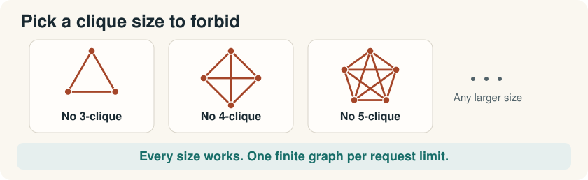

# Finite approximations of every Henson graph

The Lean extension covers **every forbidden clique size** `r ≥ 3`, not just triangles. A clique is a group of vertices all joined to one another.

* **Finite graph theorem.** For every request-size limit `k`, there is one finite graph with no `r`-clique. For each disjoint pair of groups `A, B` of total size at most `k`, if `A` contains no `(r − 1)`-clique, a vertex outside both groups is joined to all of `A` and none of `B`. See [`HensonAll.finiteCliqueExtension`](HensonAll.lean). When `r = 3`, this is the original triangle-free assertion.
* **First-order consequence.** Any sentence true in a graph satisfying the Henson extension scheme is true in some nonempty finite graph that also has no `r`-clique. This proves pseudofiniteness for every Henson graph. Different sentences may require different finite graphs. See [`HensonAll.hensonPseudofinite`](HensonLogic.lean), stated in Mathlib's first-order graph language.

The original triangle-free question appears in [Cherlin, Problems 8–9](https://sites.math.rutgers.edu/~cherlin/Paper/1992CombProblems.pdf#page=9). [Gannon, before Corollary 3.7](https://arxiv.org/html/2305.12509#S3), explicitly records the broader pseudofiniteness question. The second theorem assumes the usual Henson extension scheme on its input graph; it does not separately construct or classify the infinite Henson graphs, or assert a stronger form of asymptotic counting or measurability.



## Proof map

1. Reuse the [finite records, caches and block certificates](Problem29.lean). In each record, connect two active slots in an auxiliary graph unless their stored facts rule out adjacency in both directions. Allow only records whose active slots contain no `(r − 1)`-clique.
2. The cache condition rules out directed triangles. A hypothetical `r`-clique therefore has a vertex with an outgoing arc to each of the others. Its neighbors must occupy distinct slots: two targets sharing a slot have the same cached root and cannot be adjacent. The slots would form a forbidden `(r − 1)`-clique.
3. Build an outside witness by filling slots with the requested neighbors. Every nonadjacent target pair has stored blockers, and duplicate targets are blocked by their equal roots. Thus any clique among these slots maps injectively to a clique in the requested neighbor set. The original record-size bound is unchanged.
4. For first-order sentences, match two lists of vertices so they agree on equality and adjacency. The extension property lets such a match absorb one more vertex in either graph. Induction on formulas gives agreement up to the desired quantifier depth, including the whole input sentence.

## Replay

Use the project's pinned Lean 4.19.0 and Mathlib revision. From this directory:

```sh
lake build HensonLogic
lake env lean --trust=0 HensonAudit.lean
```

The audit checks expanded statements and guards their exact axiom reports: `propext`, `Classical.choice` and `Quot.sound` only. The original triangle-free source is unchanged. No additional toolchain or package is required.
