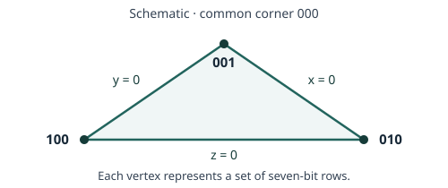

# The binary covering array number CAN(5,10,2) is 56

**26 November 2026 · computer-assisted proof.** No set of 55 ten-bit rows realizes all 32 patterns on every choice of five columns. A 56-row construction exists. Repeating a row preserves coverage, so excluding exactly 55 also excludes every smaller size.

Colbourn, Kéri, Rivas Soriano and Schlage-Puchta constructed the 56-row array in 2010. Izquierdo-Marquez and Torres-Jimenez excluded 54 rows, giving the prior lower bound of 55. Their revised author manuscript states this in §5.3 and Table 4(c). Its 2017 first version gave 54 for this entry. The new part here is the exclusion of 55. [2010 paper, Lemma 2.1](https://old.sztaki.hu/~keri/arrays/Colbourn_Keri_Rivas-Soriano_Schlage-Puchta.pdf) · [2019 paper](https://doi.org/10.1016/j.amc.2019.01.069) · [Author manuscript, v2](https://arxiv.org/pdf/1711.10040v2)

## Why small slices suffice

A binary array has strength $t$ if its rows realize every assignment to any $t$ columns. Suppose a 55-row array of strength five exists. Among all such arrays, including arrays with repeated rows, choose one with the fewest zero entries.

For every column, take the rows with entry zero and delete that column. This **zero slice** has strength four and at most 27 rows, since complementing a column with 28 or more zeros decreases the total. Every row of the slice is essential. If deleting one preserved strength four, changing its original zero to one would preserve every requirement. Patterns using that zero would still occur, patterns using a one could only gain a witness, and all other projections would be identical. This contradicts the minimum. In particular, the rows of a zero slice are distinct.

## All possible zero slices

A strength-two array on seven columns needs at least six rows. Otherwise pad to five rows and complement columns to make the first row zero. The seven column supports form an antichain on the other four rows, since each ordered pair of columns realizes 10. An antichain on four points has size at most six by Sperner's theorem. Splitting on a binary column now gives at least 12 rows for strength three on eight columns, and at least 24 for strength four on nine columns.

In any candidate slice of size $m\le27$, choose a least frequent symbol over all nine columns. Its multiplicity $q$ is 12 or 13. Its rows form a simple strength-three array $A$ on eight columns. The opposite rows form another strength-three array $B$, and their union on the eight free columns has strength four. This split is the juxtaposition principle used by Izquierdo-Marquez and Torres-Jimenez. The enumeration uses it as follows.

1. Generate $A$ by extending every surviving prefix with every binary column. Prefix rows that agree may be reordered. The new column may be complemented. At orders 1, 2 and 3 each pattern must occur at least 6, 2 and 1 times, respectively. This gives 2 simple seed types at 12 rows and 32 at 13.
2. For each seed, generate all columns of $B$ on its $m-q$ rows. For a pattern on $h$ free columns, write $a,b$ for its counts in $A,B$. Require $b\ge\mu_h$ and $a+b\ge\lambda_h$, where $\mu=(6,2,1,0)$ and $\lambda=(q,6,2,1)$ for $h=1,2,3,4$. These bounds follow by fixing columns and by the choice of $q$. The final order-three and order-four tests give exactly the required coverage. The program checks possible columns in batches of 64 using integer bit operations.
3. Retain a completed slice precisely when every row is the sole witness for some four-column pattern. Identify arrays only through row reorderings, coordinate permutations and independent bit complements. The code explicitly finds such a map before merging classes.

| Slice size | 24 | 25 | 26 | 27 |
|---|---:|---:|---:|---:|
| Essential slice types | 1 | 0 | 1 | 91 |

## Three zero slices force a triangle

Choose three columns $x,y,z$. Let $R_{abc}$ be the set of seven-bit rows left after fixing them to $a,b,c$. Put $O=R_{000}$. The three neighboring sets $R_{100},R_{010},R_{001}$ must occur in pairs. For example, the zero slice $x=0$ contains both $R_{010}$ and $R_{001}$ adjacent to $O$.



For each possible $O$, up to coordinate permutations and bit complements, build an undirected graph. In each of the 93 slice types, mark two columns and split the rows into their four cells. Choose any cell as the common corner. For **every** signed permutation of the seven free columns taking that cell onto the chosen representative $O$, join the images of the two adjacent cells by an edge. A vertex is a concrete subset of the seven-dimensional cube. Applying the same map to both endpoints preserves their relative positions.

If the hypothetical array existed, align its $R_{000}$ to the representative once. Each of its three zero slices supplies one edge in that same graph, giving a closed walk of length three. This requires a triangle or a loop. The exhaustive graphs have neither.

| Rows in $O$ | Graphs | Vertices | Edges | Loops | Triangles |
|---:|---:|---:|---:|---:|---:|
| 6 | 3 | 11,734 | 17,408 | 0 | 0 |
| 7 | 114 | 4,939 | 4,949 | 0 | 0 |
| 8 | 467 | 1,826 | 1,308 | 0 | 0 |
| 9 | 248 | 496 | 248 | 0 | 0 |

All 832 graphs are also bipartite. This contradicts the necessary closed walk and proves the lower bound of 56.

## Reproduction and upper bound

The checkout was [archodev/proofs at ede98f0](https://github.com/archodev/proofs/tree/ede98f08b9ea753d01122fae669f4b32abb92dd4). From this directory run the following with GCC and Python 3.10 or later. The programs use their standard libraries. The text file stores one slice per line, with each nine-bit row encoded as a decimal integer.

```sh
g++ -std=c++17 -O3 enumerate.cpp -o /tmp/ca55-enumerate
g++ -std=c++17 -O3 corners.cpp -o /tmp/ca55-corners
/tmp/ca55-enumerate > /tmp/ca55-types.txt
cmp /tmp/ca55-types.txt small-slices.txt
/tmp/ca55-corners < /tmp/ca55-types.txt
python3 upper.py
python3 upper.py --slices | /tmp/ca55-corners --positive
```

The SHA-256 of [the 93 representatives](small-slices.txt) is `d545f33b81f93811dcd7f848b0b7ce651b8a1f56b8b33a76762da4ebce525926`. A separate implementation using nauty produced the same 93 isomorphism classes. A separate comparison of overlapping slices also excluded all 93. The complete reproduction commands above passed a separate replay: the generated representatives matched byte for byte, all 832 graphs excluded a closed three-step walk, and the positive control found 40 triangles.

The upper-bound script constructs the Witt design $S(5,6,12)$ from the weight-six supports of the extended ternary Golay code, keeps the 36 blocks through one specified point and avoiding a second, and deletes both points. It adds the ten unit rows and their ten complements, as in the 2010 construction. It directly checks all 8,064 requirements on the 56 distinct rows. Run `python3 upper.py --rows` for the witness. As a positive control, its 28-row zero slices produce 40 triangles in the same graph test. [Original construction](https://old.sztaki.hu/~keri/arrays/Colbourn_Keri_Rivas-Soriano_Schlage-Puchta.pdf)

The maintained covering-array table, including AI-assisted constructions, still listed 56 as its best upper bound in the 26 November snapshot. The 2025 balanced-array paper determines five other parameter sets. The FrontierShift entry allows the parameters to vary. I found no prior explicit resolution of this exact instance in the sources checked. The extremal zero-count argument uses the same kind of coverage-preserving entry change studied in covering-array post-optimization. [Table snapshot](https://github.com/chrispbsmolen/ca-tools/blob/e673ab45758a3959710c662a34837f79f6add689/table/ca_table.csv) · [Hiess and Kampel](https://arxiv.org/html/2510.17596v1) · [FrontierShift](https://aitonomy.org/projects/open-problems/fs-0165) · [Nayeri, Colbourn and Konjevod](https://doi.org/10.1016/j.ejc.2012.07.017)
