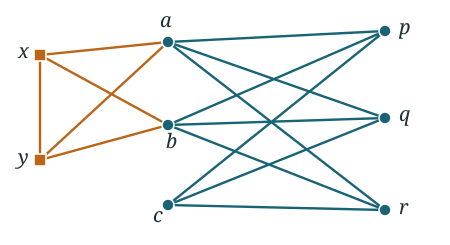

# Eight-cycles in degree-3-critical graphs

26 November 2026. Computer-assisted proof. The checker below was replayed, and a separate enumeration reproduced the conclusion. This proves the length-eight case, not the full even-length conjecture.

**Theorem.** Let $G$ be a finite simple graph on $n\ge 8$ vertices with exactly $2n-2$ edges. Suppose every nonempty proper induced subgraph of $G$ has a vertex of degree at most two. Then $G$ contains a simple cycle of length eight. The threshold is sharp. The wheel consisting of a six-cycle and its hub is degree-3-critical on seven vertices. Deleting the hub leaves a cycle, and omitting any rim vertex breaks the rim into paths.

Erdős, Faudree, Gyárfás and Schelp posed the all-length question in 1988. Narins, Pokrovskiy and Szabó constructed arbitrarily large examples missing $C_{23}$, proved the $C_6$ case in Proposition 5.1, and asked in Problem 6.1 for all even lengths up to a growing bound. Di Braccio, Katsamaktsis, Ma, Malekshahian and Zhao restated that question as Problem F in 2026. The theorem above settles the fixed length eight. The full even-length question remains open. [1988 paper](https://www.renyi.hu/~p_erdos/1988-06.pdf) · [Narins–Pokrovskiy–Szabó](https://arxiv.org/pdf/1408.5289) · [Di Braccio et al.](https://doi.org/10.1007/s00493-026-00205-2)

## Reduction to two sets of ancestors

Assume $G$ has no $C_8$. A 2-degenerate graph on $s\ge2$ vertices has at most $2s-3$ edges, by successively removing a vertex of degree at most two until two vertices remain. Every vertex deletion of $G$ is 2-degenerate by hypothesis. Hence every vertex of $G$ has degree at least three, since its deletion leaves at most $2(n-1)-3$ edges. The average degree is less than four, so choose a vertex $z$ of degree three.

The graph $G-z$ attains the bound $2(n-1)-3$. Equality at every deletion step gives the following construction in reverse order. Start from an edge with endpoints labelled 0 and 1. Add each subsequent vertex with exactly two older neighbours, its *parents*. Finally add $z$ with three older neighbours. This ordering is Theorem 1 of the 1988 paper. [Erdős et al., pp. 195–196](https://www.renyi.hu/~p_erdos/1988-06.pdf)

Delete one edge $zr$ incident to $z$ and call the resulting graph $H$. Every vertex after the initial pair now has two parents. For any vertex $t$, let $A(t)$ be the induced graph on $t$, all vertices reachable from $t$ by repeatedly taking parents, and both initial vertices. For an initial vertex, use just the initial edge, with that vertex distinguished as $t$. We call $t$ the terminal.

**Finite lemma.** In any $C_8$-free graph built from an edge by adding vertices with two parents, every $A(t)$ has at most eight vertices.

Here is why the finite check below proves the lemma at every order. Take the first terminal $t$ violating it. Its parents $u,v$ have ancestor graphs of order at most eight. Moreover, $A(t)$ is exactly the union of $A(u)$ and $A(v)$ with $t$ attached to $u,v$. Every edge other than the initial edge belongs to its younger endpoint and one of its parents, so this union accounts for all edges. The first test below exhausts these unions and finds that adjoining $t$ can give at most eight vertices.

Now every vertex of $H$ other than the initial pair, $z$ and $r$ has at least one child. It has degree at least three and only two parents. Following children strictly increases the vertex index and must end at $z$ or $r$. Consequently
$$H=A(z)\cup A(r).$$
In particular $|V(G)|\le 8+8-2=14$, since both graphs contain the initial edge. This already proves the sufficiently-large assertion. To obtain the sharp threshold, restore $zr$. The second finite test shows that every surviving case on at least eight vertices with minimum degree at least three is the graph in Figure 1. Its six vertices $a,b,c,p,q,r$ induce $K_{3,3}$, contradicting the hypothesis. The figure labels are local to the drawing. This proves the theorem.

*Figure 1. The graph left by the cycle and minimum-degree tests. The squares are adjacent to one another and to both $a$ and $b$. The six circles certify failure of induced criticality.*

## Reproducible finite check

Run `python3 verify.py` in this directory. The verifier uses only the Python standard library and retains all construction labellings. Its two tests use the same list of 403 inputs.

1. Generate every two-parent construction on at most eight vertices. Retain it as an ancestor graph if every noninitial vertex before the terminal occurs as a parent. Following children then leads to the terminal. Include the two choices of terminal on the initial edge.
2. For every ordered pair of retained graphs, fix the initial labels in both. Keep the whole first graph and process the second in its construction order. Each vertex either coincides with an unused vertex of the first graph with the same two parents, or is new. These alternatives exhaust the identifications in an actual union, since every ancestor graph contains both parents of every noninitial vertex it contains.
3. When adjoining a vertex at parents $u,v$, discard the branch exactly when the current graph has a simple $u$–$v$ path of six edges. Such a path closes through the new vertex to give $C_8$. At a completed union with distinct terminals, apply this test to adjoining a common child. Separately, test inserting an edge between nonadjacent terminals. In that case the forbidden path has seven edges. For each surviving extra-edge graph of order at least eight and minimum degree at least three, the verifier matches the full adjacency lists to Figure 1.

| Number of vertices | 2 | 3 | 4 | 5 | 6 | 7 | 8 | Greater than 8 |
|---|---:|---:|---:|---:|---:|---:|---:|---:|
| Input ancestor graphs | 2 | 1 | 2 | 7 | 38 | 295 | 58 | — |
| Cases after adjoining a common child | 0 | 2 | 4 | 13 | 64 | 458 | 112 | 0 |
| Extra-edge cases passing the order and degree tests | — | — | — | — | — | — | 20 | 0 |

The entries count construction records, so a graph can occur more than once. All 20 records in the last row match Figure 1.

The ancestor bound and finite verification are the argument presented in this note. A literature and catalogue check on 26 November 2026 found no earlier explicit resolution of the fixed $C_8$ statement. [Erdős Problem 815](https://www.erdosproblems.com/815) · [AI contributions catalogue](https://github.com/teorth/erdosproblems/wiki/AI-contributions-to-Erd%C5%91s-problems)
