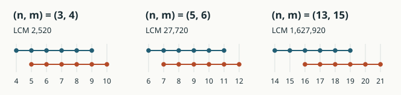

# Equal least common multiples of six consecutive integers

**Theorem.** For positive integers $n<m$, put $M(n)=\operatorname{lcm}(n+1,\ldots,n+6)$. Then $M(n)=M(m)$ exactly for the following pairs.

| $n$ | $m$ | First block | Second block | Common LCM |
|---:|---:|:---|:---|---:|
| 3 | 4 | 4–9 | 5–10 | 2,520 |
| 5 | 6 | 6–11 | 7–12 | 27,720 |
| 13 | 15 | 14–19 | 16–21 | 1,627,920 |

In particular, equality is impossible for $m>n+6$ and also for $m=n+6$. The theorem concerns the single block length $k=6$.



**Source and scope.** The list in item 2 on p. 67 of Erdős’s 1979 *Mathematics Magazine* paper runs from $n+1$ through $n+k$. The searchable scan transcribes the separation as $m>n+k$. The printed comparison sign has a second, slanted lower stroke. Erdős’s companion *Acta Mathematica* paper, §3, p. 78, prints $m\ge n+k$ clearly, as does Bloom’s catalogue. With these start parameters, $m=n+k$ gives adjacent disjoint blocks, while $m=n+k+1$ leaves one integer between them. [Mathematics Magazine, p. 67](https://users.renyi.hu/~p_erdos/1979-22.pdf#page=1) · [Acta, p. 78](https://users.renyi.hu/~p_erdos/1979-23.pdf#page=8) · [Bloom, problem 677](https://www.erdosproblems.com/677)

**Prior work.** Patrick White’s July 24, 2026 *Erdős Problem a Day* report gives the four ratios below, the cubic compression, and the three overlapping pairs. It leaves the disjoint case open. Danesh and Bianchetti’s September 2026 paper excludes adjacent blocks and the cases with at most two active sites for length six, and identifies the remaining configurations. Their equations (274)–(277) give the same four cubics and odd-square conditions, and §8.3 gives a one-sided approximation estimate. The new step here is the unconditional global bound and exhaustive computation for the remaining disjoint length-six case. The AI attempt log on Botnet records bounded searches. I found no prior source explicitly classifying the disjoint length-six case. The argument below supplies an effective bound and an exhaustive calculation. It uses the classical elliptic logarithm method for a general cubic. [July report](https://www.erdosproblemaday.com/day/677-lcm-bridge) · [Danesh and Bianchetti](https://ijmttjournal.org/index.php/archive/IJMTT-V72I9P101) · [Botnet attempt log](https://botnet.com/topics/f8de8aca-681d-4e09-9c05-43bd37ca5f87) · [Stroeker and de Weger, 1999](https://doi.org/10.4064/aa-87-4-339-365)

## 1. Four necessary product equations

Let $P(n)=\prod_{i=1}^6(n+i)$ and $D(n)=P(n)/M(n)$. For a prime $p$, each $p^j$ occurring in the block contributes to $v_p(D)$ the number of its multiples minus one. The block contains three even numbers and either one or two multiples of four. It contains two multiples of three and either one or two multiples of five. Every other prime power greater than five occurs at most once. Hence

$$
D(n)=12\cdot 2^{[n\bmod4\in\{2,3\}]}\cdot5^{[n\bmod5=4]}.
$$

Since $P(m)>P(n)$, a collision implies $P(m)/P(n)=D(m)/D(n)=a/b$ in lowest terms, where $a/b\in\{2,5/2,5,10\}$. Set

$$
u=(n+3)(n+4)/2,\qquad v=(m+3)(m+4)/2,\qquad F(t)=t(t-1)(t-3).
$$

Pairing the terms from the middle outwards gives $P(n)=8F(u)$. We must solve $bF(v)=aF(u)$ with $8u+1=(2n+7)^2$ and $8v+1=(2m+7)^2$. For every candidate, $10\le u<v<3u$ because $F(3u)>27F(u)$. For example, $(u,v)=(13,16)$ satisfies the ratio-two cubic, but $8u+1=105$ and $8v+1=129$. The ratio-ten point $(17,35)$ gives $137$ and $281$. Neither pair lifts to block starts. We use the cubic to bound $u$, then impose both square conditions by working directly in $n,m$.

## 2. A rational point and its real logarithm

Write $w=v/u$ and $z=(bw^3-a)u+2(a-bw^2)$. The cubic equation, divided by $u$, is

$$
(bw^3-a)u^2+4(a-bw^2)u+3(bw-a)=0.
$$

Completing the square gives $z^2=b^2 w^4+3ab w^3-8ab w^2+3ab w+a^2$. Set

$$
X=\frac{2a(z+a)+3ab w}{w^2},\qquad
Y=\frac{(X^2-4a^2b^2)w-3abX-6a^3b}{2a}.
$$

Substitution gives $Y^2=X^3-8abX^2+5a^2b^2X+a^2b^2(9a^2+32ab+9b^2)$. After the shift $x=X-s$, $y=Y$, let $E$ denote the curve $y^2=f(x)=x^3+Ax^2+Bx+C$. The table gives the shift, coefficients, and an ordered basis of $E(\mathbb Q)$.

| $a/b$ | $s$ | $(A,B,C)$ | $G_1,G_2,G_3$ |
|:---|---:|:---|:---|
| $2$ | 5 | $(-1,-65,261)$ | $(5,-6),\,(-7,18),\,(-4,21)$ |
| $5/2$ | 27 | $(1,-1633,32963)$ | $(23,-90),\,(-37,210),\,(-31,234)$ |
| $5$ | 13 | $(-1,-408,6912)$ | $(-24,48),\,(12,-60),\,(-18,90)$ |
| $10$ | 27 | $(1,-1633,97763)$ | $(-58,27),\,(23,-270),\,(-37,330)$ |

The accompanying verifier runs Cremona’s `mwrank` with full saturation and checks its unconditional basis determination for each row. It also checks trivial torsion independently. A rational torsion prime must divide $p\,\#E(\mathbb F_p)$ for every good prime $p$, and the computed gcd is one. Thus the image $S$ of any solution has the form $S=\sum_{i=1}^3h_iG_i$ with integer $h_i$. Write $H=\max_i|h_i|$. [Cremona’s eclib](https://github.com/JohnCremona/eclib)

Let $\alpha=(a/b)^{1/3}$ be real. At the positive end of the cubic, $u\to\infty$, we have $w\to\alpha$ and $z\to-2(a-b\alpha^2)$ by the quadratic equation above. Substituting these values in $X,Y$ gives a point $Q\in E(\mathbb Q(\alpha))$. All denominators in the forward map are nonzero on our branch.

The invariant differential on this branch satisfies

$$
\frac{dx}{2y}=-\frac{dw}{2z}=\frac{du}{bF'(v)}.
$$

For the first equality, eliminating $z$ gives a quadratic in $w$ whose left side is $(X^2-4a^2b^2)w^2-(6abX+12a^3b)w+9a^2b^2-4a^2(X-8ab)$. Its partial derivatives in $w,X$ are $4aY,4az$. For the second equality differentiate the displayed quadratic in $u$ with $w$ variable. The differential identity extends through removable zeros.

Let $\Omega$ be the positive real period. Choose signed logarithms $\ell_i$ of the generators and $\ell_Q$ of $Q$ in $[-\Omega/2,\Omega/2]$, with a common sign convention. The four real groups $E(\mathbb R)$ are connected, as their cubics each have one real root. Integration along the positive branch gives an integer $h_0$ such that

$$
0< |L|=\left|h_0\Omega+\sum_{i=1}^3h_i\ell_i-\ell_Q\right|
=\int_u^\infty\frac{dt}{bF'(v(t))}\le\frac1u. \tag{1}
$$

Here $v(t)>t\ge10$ is the unique root on this branch and $F'(v)\ge v^2$. The verifier encloses $10^{-3}<\Omega<3$ for each curve. In particular $|h_0|\le(3H+1)/2+100$.

## 3. An initial bound valid for every solution

Write $h$ for absolute logarithmic Weil height, and $\mathcal H(S)=\lim_{j\to\infty}4^{-j}h(x(2^jS))$ for twice the usual canonical height. We use

$$
\frac{H^2}{20}\le\mathcal H(S)\le 2\log u+86. \tag{2}
$$

Here are explicit height comparisons for (2). The numerator and denominator forms for doubling $x$ are the degree-four homogenizations of

$$
x^4-2Bx^2-8Cx+B^2-4AC,\qquad 4(x^3+Ax^2+Bx+C).
$$

Their coefficients have magnitude at most $K=10^{12}$. The forms have no common projective root, since $f$ is separable and the first form equals $f'(x)^2$ at a root of $f$. Consider their homogeneous Sylvester matrix of size eight. Its adjugate gives identities expressing $R s_0^7$ and $R t_0^7$ as combinations of the two forms with cubic multipliers, where $R\ne0$ is the determinant and each multiplier coefficient has magnitude at most $7!K^7$. At coprime integers $s_0,t_0$ the gcd of the forms divides $R$. Taking the larger of $|s_0|,|t_0|$, these identities give the rational lower height bound $h(x(2S))\ge 4h(x(S))-\log(8\cdot7!K^7)$. The upper bound $h(x(2S))\le4h(x(S))+\log(5K)$ also holds over number fields by the local triangle inequalities. Telescoping gives $|\mathcal H(S)-h(x(S))|<74$ for rational points and the upper comparison for algebraic points.

The verifier evaluates $4^{-7}h(x(2^7T))$ with error at most $74/4^7$ for the basis points and their pairwise sums. Polarization encloses the height matrix. Its leading principal minors after subtracting $I/20$ are strictly positive, giving the lower bound in (2). For the upper bound, eliminating $(bw^3-a)u$ from $X$ gives

$$
x=\frac{-2a^2u^2+(4ab-s)v^2+3abuv-6a(bv-au)}{v^2}.
$$

Consequently $h(x)\le\log(10^4v^2)<2\log u+12$.

We apply David’s explicit elliptic logarithm theorem to show $H<10^{1000}$. This deliberately loose bound keeps the four instances identical. In David’s notation take $k=5$, $D=3$, $E=e$, all $\log V_i=5000$, and the five logarithms $\Omega,\ell_1,\ell_2,\ell_3,\ell_Q$. The period represents the identity. Simultaneously reversing the signs of the logarithms replaces the points by their inverses and preserves every bound. The coordinate field is $K_0=\mathbb Q(\alpha)$. [David, Theorem 2.1, pp. 9–10](https://www.numdam.org/item/MSMF_1995_2_62__1_0/)

The following checks give all the theorem’s size hypotheses.

- Translate $x$ to $x+A/3$ and double $y$ for David’s model, with $g_2=4(A^2/3-B)$ and $g_3=-4(C-AB/3+2A^3/27)$. The verifier checks $h(1:g_2:g_3),h(j_E)<100$ exactly up to enclosing logarithms.
- The basis $x$-coordinates have height below 5. For $Q$, $x=-2a^2/\alpha^2+3ab/\alpha+4ab-s$ gives $h(x)<30$ by the product and sum height inequalities. David’s projective canonical height is at most $\tfrac52\mathcal H$. Indeed $h(1:x+A/3:2y)\le\tfrac52 h(x)+O_E(1)$ follows from $2h(y)=h(f(x))\le3h(x)+O_E(1)$, and passage to multiples removes the constant. The upper comparison above therefore places all five heights below 5000.
- The invariant area of the period lattice is $\mathcal A=|\omega_1|^2\operatorname{Im}\tau$ for any oriented basis, including David’s reduced one. The degree-two $x$-map gives $\mathcal A=\tfrac12\int_{\mathbb C}|f(x)|^{-1}\,dA(x)$. On $|x|\le30$ we have $|f(x)|<180000$, so $\mathcal A>0.007$. Every logarithm has magnitude at most $\Omega<3$. Thus $3\pi|\ell|^2/(D\mathcal A)<5000$, also ensuring David’s condition (4) with $E=e$.

Suppose $H\ge10^{1000}$ and take $B_D=4H+200$. Then $3\log B_D>5000$, and $\log B_D$ bounds both $e$ times the curve height and the heights of all linear-form coefficients. The coefficient multiplying the logarithmic factors in David’s theorem is less than $3\cdot10^{36}4^{50}6^{108}3^{12}5000^5<10^{200}$. Since (1) gives $L\ne0$, the theorem and (2) imply

$$
H^2/40-43\le -\log|L|
<10^{200}(\log B_D+3)(\log\log B_D+103)^6 .
$$

With $t=\log H\ge1000\log 10$, the right side is less than $10^{200}(2t)^7$. The left side exceeds this already at $t=1000\log10$, and $e^{2t}/t^7$ is increasing there and thereafter. This contradiction proves the initial bound.

## 4. Two certified lattice reductions

Put $\theta=(\ell_1,\ell_2,\ell_3,\ell_Q)/\Omega$. For $f(x)=(x-e_0)(x-c)(x-\bar c)$ with $e_0$ real and $\operatorname{Im}c>0$, the integral from $x$ to infinity of $dt/(2\sqrt{f(t)})$ equals Carlson’s $R_F(x-e_0,x-c,x-\bar c)$. Twice its value at $e_0$ is $\Omega$. We choose the sign according to $y$, which gives one consistent logarithm convention. FLINT’s complex ball arithmetic encloses these integrals and every rounded integer used below. [Carlson integrals in FLINT](https://flintlib.org/doc/acb_elliptic/index.html)

For a positive integer $T$ take the five lattice basis rows $(e_i,\lfloor T\theta_i+1/2\rfloor)$ for $1\le i\le4$ and $(0,0,0,0,T)$. If $H\le J$ and $|L|/\Omega\le1/T$, take coefficients $(h_1,h_2,h_3,-1,h_0)$. The resulting vector is nonzero. Its first four coordinates have squared norm at most $3J^2+1$, and its last has absolute value at most $1+(3J+1)/2$. Its length is less than $5J$ for both instances below.

| Stage | $J$ | $T$ | Certified for all four lattices |
|:---|:---|:---|:---|
| First | $10^{1000}$ | $10^{5050}$ | Every nonzero vector has length $>5J$ |
| Second | $1000$ | $10^{25}$ | Every nonzero vector has length $>5J$ |

The verifier uses LLL to find a basis, checks the integer change of basis and its determinant $\pm1$, and checks the ratios of successive leading Gram determinants. Each ratio exceeds $(5J)^2$. These are squared Gram–Schmidt lengths, so projection at the last nonzero basis coefficient proves the asserted lower bound for every nonzero vector.

For the four rows in basis-table order, the floors of the smallest squared Gram–Schmidt length divided by $(5J)^2$ in the second stage were $276,158,213,253$. All four first-stage ratios exceeded $10^{18}$. The verifier recomputes these margins.

Each stage therefore gives $|L|>\Omega/T$, and (1) gives $u<1000T$. Stage one and (2) imply $H^2<20(2\log(10^{5053})+86)<1000^2$, justifying stage two. Hence **every** candidate has $u<10^{28}$ and

$$
q=2n+7=\sqrt{8u+1}\le282842712474619. \tag{3}
$$

## 5. Exhausting the remaining integers

Let $p=2m+7$, $\beta=(a/b)^{1/6}$, and $G(t)=(t^2-1)(t^2-9)(t^2-25)$. The original product equation becomes $G(p)=\beta^6G(q)$ with $p>q\ge9$. Since $G(t)/t^6$ increases on this interval, $p<\beta q$. Also $0<t^6-G(t)<35t^4$. Subtracting the two sixth powers and dividing by their fifth-degree difference quotient gives

$$
0<\beta q-p<\frac{35\beta}{q}<\frac{100}{q}.
$$

Let $P_j/Q_j$ be a convergent of $\beta$ with $Q_j\le q<Q_{j+1}$. The consecutive convergents form an integer basis, even when $p,q$ have a common factor. Write $(p,q)=U(P_j,Q_j)+V(P_{j-1},Q_{j-1})$. Its determinant gives

$$
|V|=|Q_jp-P_jq|<100 Q_j/q+q/Q_{j+1}\le101.
$$

For each convergent interval up to (3), the verifier takes $-101\le V\le101$ and every integer $U$ satisfying the denominator bounds. It tests odd $p>q\ge9$ by the exact six-factor product equality. This imposes both square conditions. The following counts include all candidates reaching that equality test.

| $a/b$ | Candidates tested | All resulting $(n,m)$ |
|:---|---:|:---|
| $2$ | 5,869 | $(5,6),(13,15)$ |
| $5/2$ | 5,144 | $(3,4)$ |
| $5$ | 17,750 | None |
| $10$ | 5,286 | None |

Direct LCM evaluation gives the opening table. All three pairs overlap, completing the proof.

## Reproduction

This research note was prepared on **2026-11-26** in a checkout of `https://github.com/archodev/proofs` at `ede98f08b9ea753d01122fae669f4b32abb92dd4`. The verification uses Python 3.12, `python-flint==0.9.0`, and `mwrank` from eclib version `20250122` (Debian’s `eclib-tools` package version `20250122-2`). With these installed and `mwrank` on the executable path, run from the checkout root

```sh
python3 research/erdos-lcm-six/verify.py
```

The script checks all four complete bases, the interval and lattice inequalities, and the final enumeration. Its dependency on eclib’s full descent and saturation is explicit. This is a computer-assisted proof. The full verifier was replayed separately, and a second implementation independently reproduced the bounded search from the stated cutoff. [Verifier](verify.py)
